<h1 align="center">SeaBathy Desktop</h1>

<b>Plan your trips on the big screen.</b> 
Depth surveys, a 3D seabed, tides, sea conditions and route planning, for Windows.

  
  
  
  
  

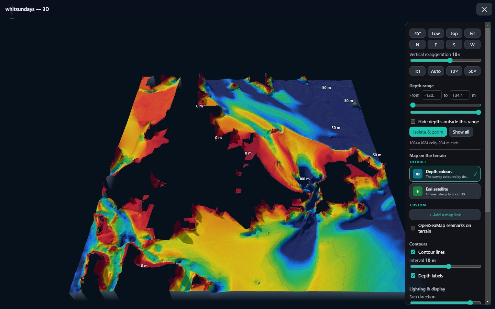

SeaBathy Desktop is the [SeaBathy](https://github.com/SeaBathy/seabathy-android) Android
app for Windows: the same chart, survey colours, 3D view, offline maps, sea conditions,
tides, waypoints and route planning, laid out the same way. Open your depth surveys, spin
the seabed around in 3D with satellite imagery on top, and plan routes that show the least
depth on every leg. One portable exe: no install, no account, no tracking.

> **Not for navigation.** SeaBathy does not include official nautical charts. Use it
> alongside proper charts and navigation equipment, never instead of them.

**New here?** The [how-to guide](https://seabathy.com/guide) shows the whole path in a few minutes: get a free depth file with BathyPicker, open it on your phone or PC, and put it on your chartplotter with AT5 Chart Maker.

## Contents

- [Highlights](#highlights)
- [Screenshots](#screenshots)
- [Download and run](#download-and-run)
- [How to](#how-to)
- [All features](#all-features)
- [Privacy](#privacy)
- [Credits and licence](#credits-and-licence)

## Highlights

| | |
|---|---|
| 🗺️ **Your surveys, sharp** | Open GeoTIFF depth surveys (or drag them onto the window), coloured with the phone's palettes and relief shading, sharp to the file's full resolution. |
| 🏝️ **3D seabed** | Any depth layer in 3D, with the height exaggerated from 0.5× to 100× so reefs and drop-offs stand out, satellite or your offline maps draped over it, contours, profiles and a sharper map as you zoom in. |
| 🧭 **Route planning** | Click points on the chart for distance, time, ETA and fuel, with the least survey depth on every leg against your draft. |
| 🌊 **Free depths anywhere** | Download seabed depths for the area on screen, anywhere in the world (GMRT). |
| 🌡️ **Tides and sea conditions** | Tide charts, wind, waves, swell, currents, sea temperature and more, saved for offline use, in the units you choose. |
| 📶 **Works offline** | Save satellite maps for any area as MBTiles, and take them to the phone app too. |

## Screenshots

| | |
|:---:|:---:|
| 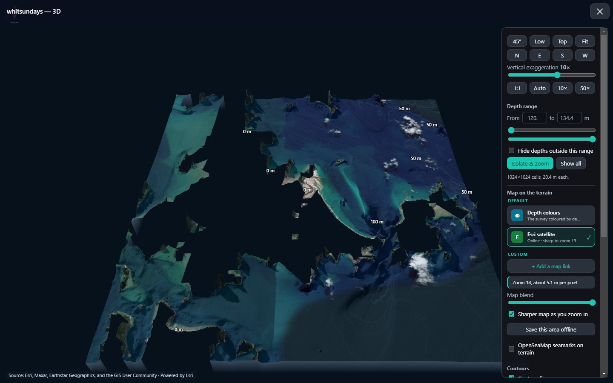 **Satellite on the 3D seabed**: Whitehaven Beach and Hill Inlet | 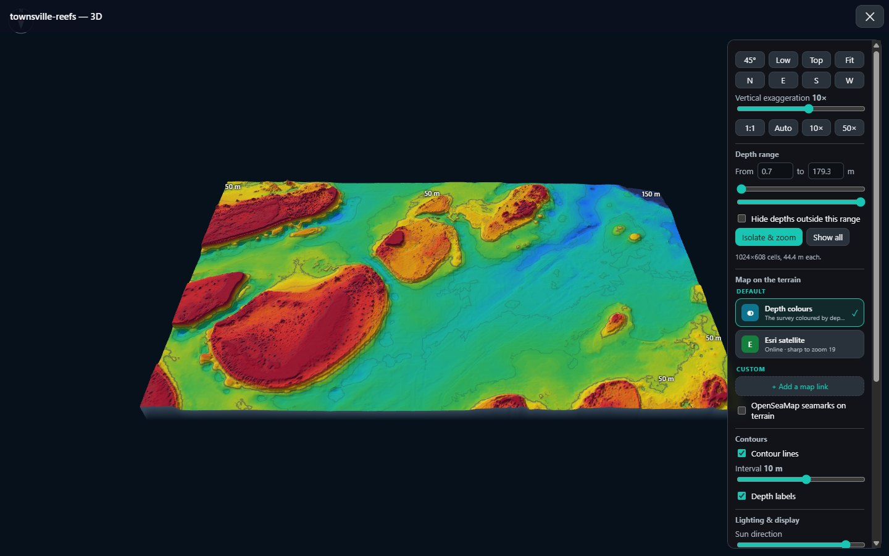 **Reefs in 3D**: a 10 m survey off Townsville |
| 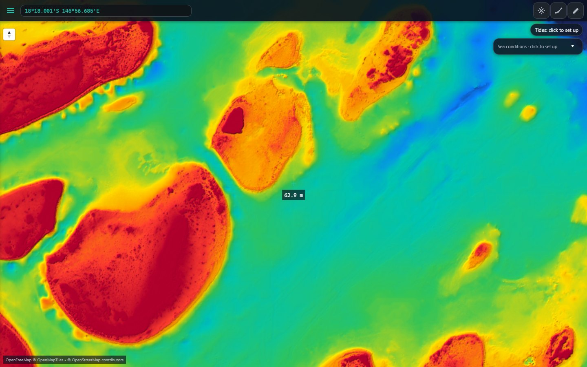 **Your survey on the chart**, with the depth at the crosshair | 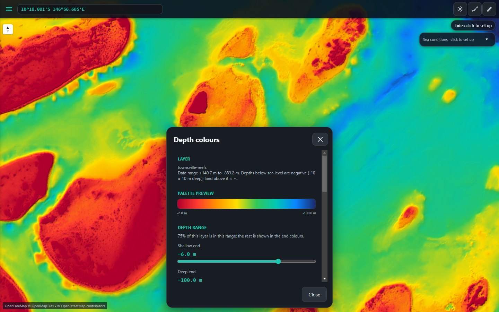 **Depth colours**: palettes, presets and your own range |
| 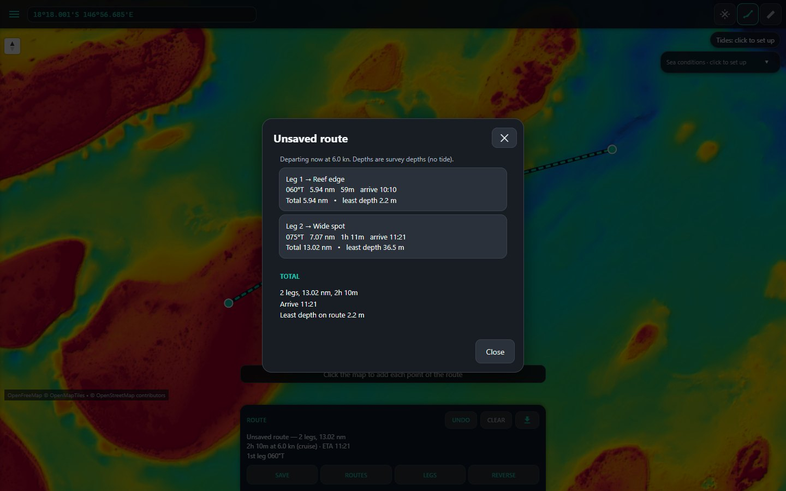 **Route planning**: bearing, distance, time and least depth per leg | |

### Vertical exaggeration

Hardy Reef and Heart Reef on the Great Barrier Reef, a 10 m survey made with
[BathyPicker](https://github.com/SeaBathy/BathyPicker). Exaggerating the height makes
every reef wall, channel and bommie stand out; the satellite picture is draped over the
same terrain.

| 10× | 100× |
|:---:|:---:|
| 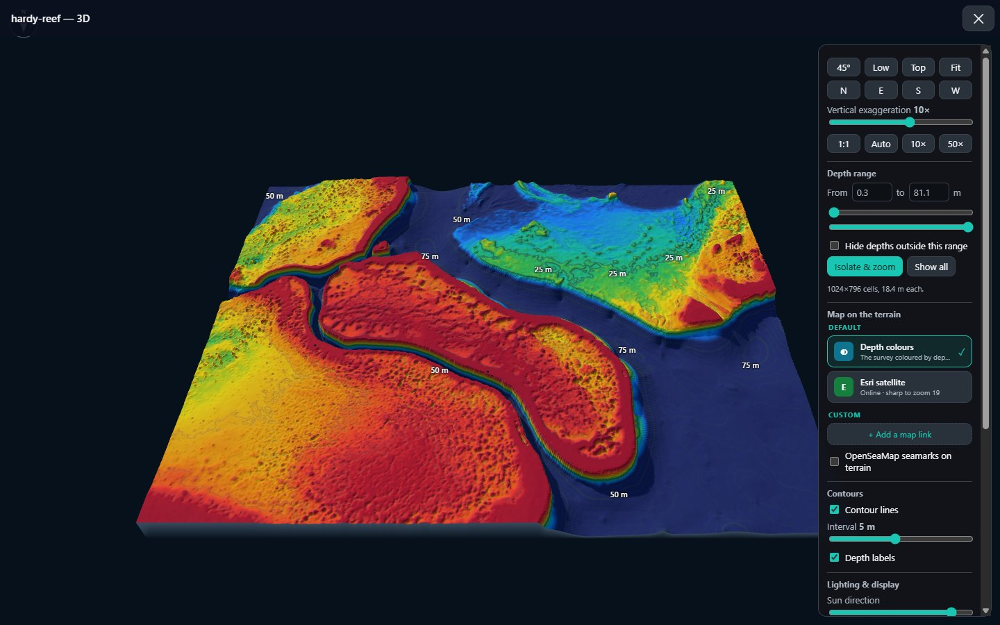 Depth colours at 10× | 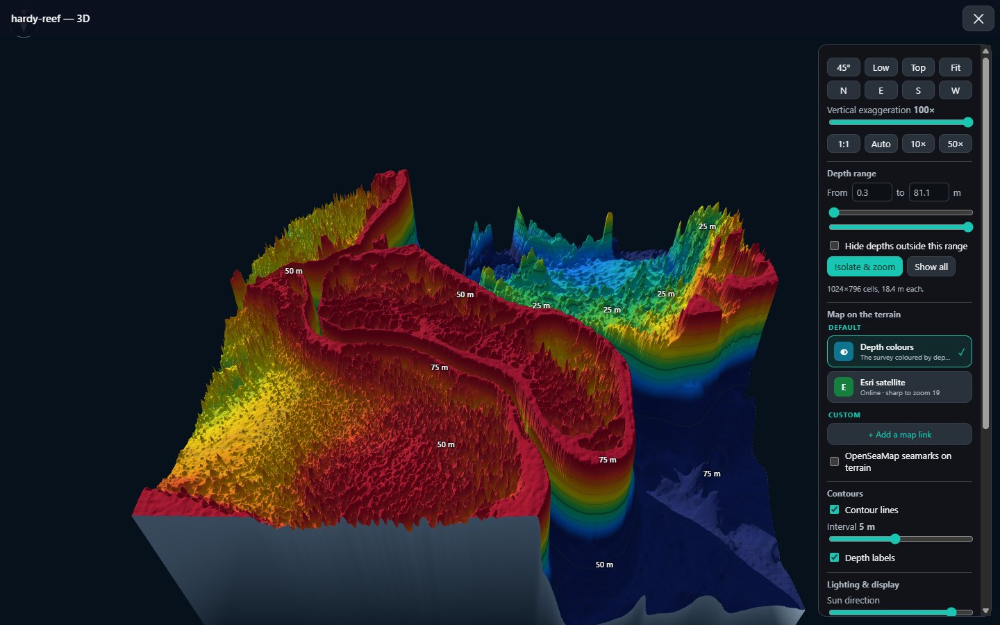 Depth colours at 100× |
| 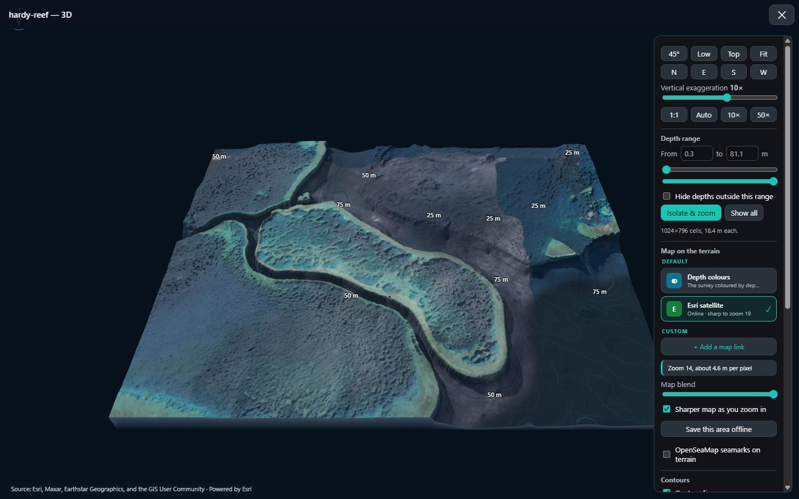 Satellite at 10× | 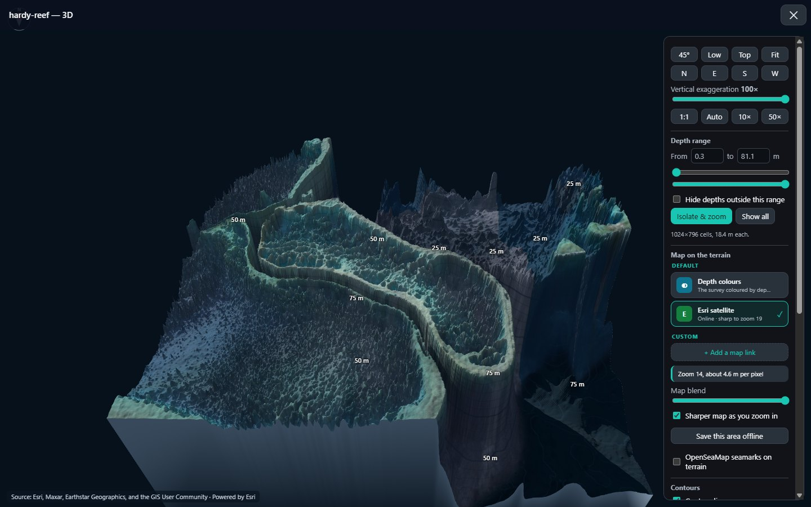 Satellite at 100× |
| 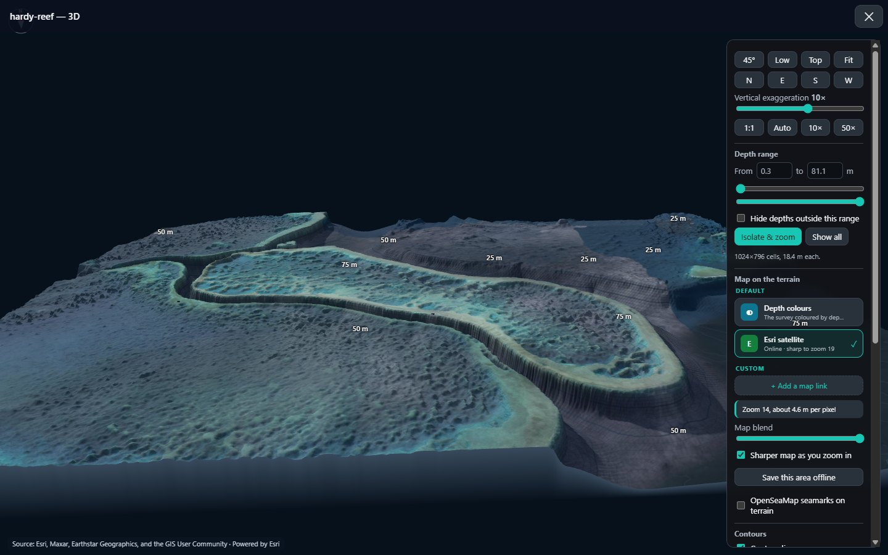 **Zoomed into the reef** at 10×: the satellite stays sharp up close | 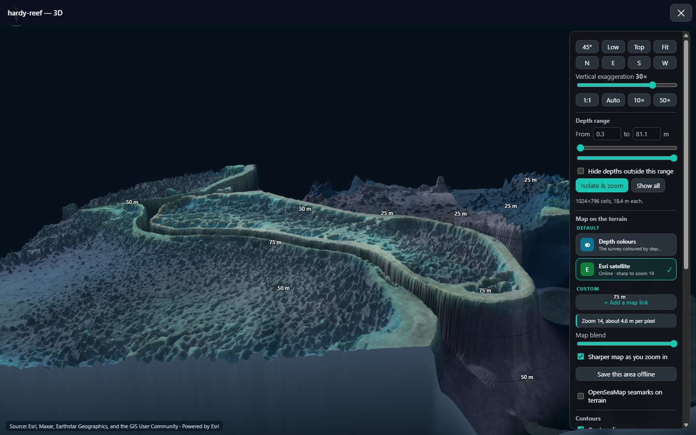 The same view at 30×: the reef wall drops away into the channel |

## Download and run

1. Download **[`SeaBathy-Desktop-1.0.2.exe`](download/SeaBathy-Desktop-1.0.2.exe)** (or from
   the Releases page).
2. Double-click it. There's nothing to install.
3. The first time, Windows may say *"Windows protected your PC"*, because the exe isn't
   signed by a big company. Click **More info**, then **Run anyway**.

Runs on 64-bit Windows 10 and 11. Your settings, waypoints and routes are kept in
`%APPDATA%\SeaBathy Desktop`.

## How to

<b>Open a depth survey or chart</b>

Drag a `.tif` GeoTIFF or `.mbtiles` chart onto the window, or use **☰ → Settings → Load
GeoTIFF / Load MBTiles**. The map flies to it. In the layer list, **Colours** sets the
palette and depth range; the presets (reef and shallows, inshore, coastal, offshore) are a
quick start.

For Australian waters, [BathyPicker](https://github.com/SeaBathy/BathyPicker) makes a
high-detail GeoTIFF of any area.

<b>See the seabed in 3D</b>

Click **3D view** on a depth layer. Drag to rotate, right-drag to pan, scroll to zoom.
`F` fits, `T` looks from the top, `5` goes back to 45°. In the panel:

- **Vertical exaggeration** from 1:1 up to 100× makes reefs and drop-offs stand out: drag the slider, or use the 1:1, Auto, 10× and 50× buttons.
- **Map on the terrain**: depth colours, Esri satellite, your offline packs or your own map
  link, with a blend slider. *Save this area offline* downloads the map under the 3D view.
- **Depth range** with *Isolate & zoom* shows one band at full detail.
- **Contours**, **sun and shadows**, and **profiles** (Alt+drag).

<b>Plan a route</b>

Click the route tool, then click the chart (or waypoints) to add points. **Legs** lists each
leg's bearing, distance, time, fuel and the least survey depth against your draft plus safety
margin. Save, reverse, rename, and export as GPX. `Backspace` takes back the last point.

<b>Waypoints and GPX</b>

Click the **Waypoint tool**, then click the chart where the mark goes, and give it a name, icon,
colour and notes. **☰ → Settings → Import GPX** reads waypoints and routes from a chartplotter,
the phone app or another program; **Export waypoints and route** saves yours as GPX for the phone
or plotter.

<b>Save maps for offline use</b>

Move the map to the area and use **Offline maps → Download the area on screen**. Files go to
`Documents\SeaBathy\OfflineDownloads` as MBTiles, which the phone app opens too. The built-in
source is Sentinel-2 cloudless satellite imagery.

<b>Tides and sea conditions</b>

Click the **Tides** chip to search a place and see the chart for the next day and a half,
then save months ahead. Click **Sea conditions** to download a spot or area and show wind,
current, waves, swell, sea temperature, temperature breaks, chlorophyll, sea level, salinity or
the temperature at a depth you choose, with flow lines and a time slider. The values box shows
surface readings, the temperature at your chosen depth, then salinity and sea level; click a line
to show that layer. Units are in the route and boat settings.

## All features

<b>Chart and surveys</b>

- Dark and street basemaps (OpenFreeMap), your own XYZ basemap or none; an offline fallback
- GeoTIFF depth surveys and imagery, sharp to full resolution as you zoom in; big files read in windows, internal overviews used
- MBTiles charts (raster or contour vector) and online XYZ layers, with order, opacity, visibility and quality
- Depth at the crosshair as you pan; seven palettes, depth range by hand or auto-fit, relief shading

<b>3D</b>

- Camera presets, compass directions, exaggeration 0.5–100×
- Depth range with Isolate & zoom at full resolution, contour lines and labels
- Esri satellite, offline MBTiles and your own map links on the terrain, with a blend slider
- Sharper map as you zoom in; save the 3D area's map offline
- Sun and shadows, sea surface, depth profiles

<b>Planning and data</b>

- Waypoints with names, icons, colours, notes, coordinate entry (DDM / DMS / DD) and search
- Routes with distance, time, ETA, fuel, and per-leg bearing and least depth against draft plus margin
- Boat and units: distance, speed, depth, fuel, tide height, wind (incl. Beaufort), waves, current, °C or °F
- GPX import and export of waypoints and routes
- Free seabed depths anywhere (GMRT); NASA's daily true colour picture; a latitude and longitude grid
- Tides with highs, lows, night and heights above LAT, saved offline
- Sea conditions worldwide, saved offline, with flow lines, a time slider and values at the crosshair; temperature at a depth you choose (10 to 300 m)

The parts of the phone app that need the boat's GPS (follow me, tracks, navigating a route,
anchor and depth alarms) are left out of the desktop version.

## Privacy

SeaBathy Desktop has no accounts, ads or analytics, and sends nothing to this project. When
you use an online map or data service, your PC asks that service directly, so it sees your
IP address and the area you asked for. Surveys, waypoints and routes stay on your PC. The
debug log is only shared if you share it.

**Offline downloads:** the built-in offline source is Sentinel-2 cloudless, whose licence
allows it. You can also download from any other map or link; that's your choice and your
responsibility under that provider's terms. Nothing is hosted or redistributed by this
project.

## Credits and licence

- **Code:** MIT licence, see [LICENSE](LICENSE).
- **Libraries:** [THIRD_PARTY_NOTICES.md](THIRD_PARTY_NOTICES.md). Full licence texts are in the app under Settings → Licences and credits.
- **Maps and data:** each map's credit is shown on screen while it's shown. Every source, its credit and its terms: [DATA_ATTRIBUTION.md](DATA_ATTRIBUTION.md).
- **Building from source and testing:** [DEVELOPMENT.md](DEVELOPMENT.md).
- **Changes:** [CHANGELOG.md](CHANGELOG.md).

Also from SeaBathy: the [Android app](https://github.com/SeaBathy/seabathy-android),
[BathyPicker](https://github.com/SeaBathy/BathyPicker) and
[AT5 Chart Maker](https://github.com/SeaBathy/AT5-Chart-Maker).

Screenshots use a 10 m survey of reefs off Townsville, and IMAS bathymetry (CC BY 4.0) of the
Whitsundays and of Hardy and Heart Reefs made with BathyPicker. IMAS covers the seafloor only,
so in the Whitsundays shots the island heights come from GMRT (CC BY 4.0).
